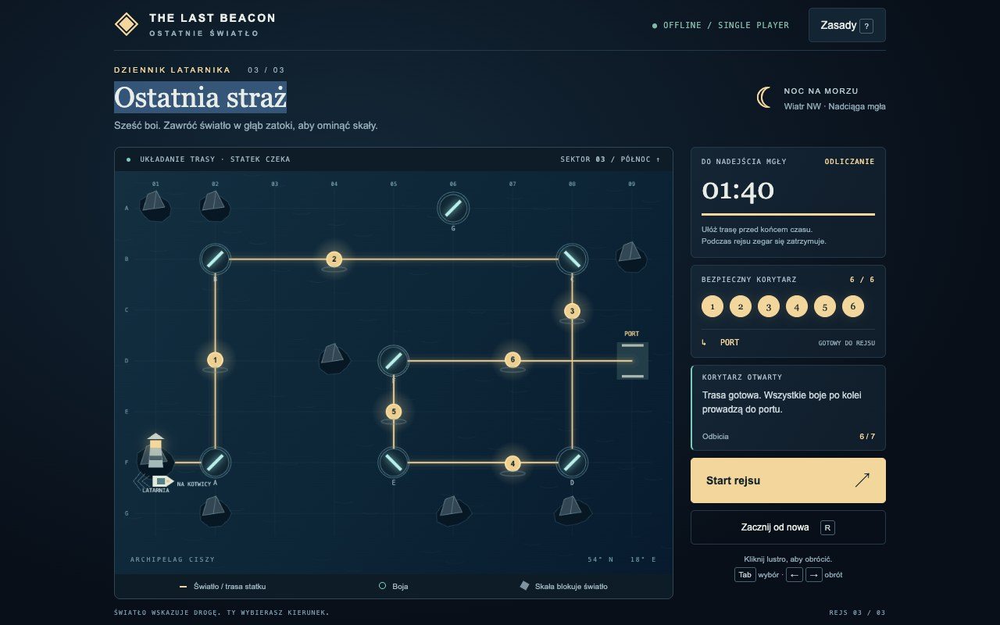

# The Last Beacon

[](https://make.fun/bounty/best-game-01?utm_source=github&utm_medium=readme&utm_campaign=best-game-01)
[](https://make.fun/bounty/best-game-01/leaderboard?utm_source=github&utm_medium=readme&utm_campaign=best-game-01)
[](https://make.fun/bounty/best-game-01?utm_source=github&utm_medium=readme&utm_campaign=best-game-01)

An original, compact lighthouse puzzle about bringing the last ship home. Rotate mirrors to carry one continuous beam through numbered buoys and into the harbor before fog arrives. Three handcrafted voyages, a procedural night sea, animated waves and a ship that waits for your explicit launch. Polish in-game instructions and feedback.



## Play offline

Open `game/index.html` directly in desktop Chrome. No installation, server, build, account, CDN, fonts, audio files or network access is needed. The README's optional competition badges are external; the game itself never requests them.

- Click a mirror to switch between `/` and `\`.
- Tab selects a mirror; Left, Right, Enter or Space rotates it.
- Light must meet buoy **1 → 2 → 3…**, all in a single current beam, then reach the port.
- Rocks stop light. Intersections without a mirror continue straight.
- A live report explains a rock, missing buoy, wrong order, escaped beam, loop or reflection limit.
- The ship waits while you plan. **Start rejsu** locks the mirrors, stops the planning timer and sails along the beam. An invalid route loses; a valid route reaches the harbor.
- Running out of planning time loses. R or the restart button resets the current voyage.
- The help dialog pauses the timer. Escape closes help. The final result offers a full campaign restart.

## Build the competition output

Requires Node.js >=22.18, standard library only:

```sh
MAKEFUN_OUTPUT_DIR=out node main.ts
```

This creates `out/game/`, `out/screenshots/` and the canonical `out/dossier.json` using the **unchanged** official `vendor/makefun-game.ts`. Without the environment variable it writes `/output`, as required by the competition runtime.

## Verify

```sh
node tests/logic.cjs
```

Browser verification uses optional Playwright test tooling and an installed desktop Chrome:

```sh
PLAYWRIGHT_MODULE=/absolute/path/to/playwright \
CHROME_PATH='/Applications/Google Chrome.app/Contents/MacOS/Google Chrome' \
node tests/browser.cjs
```

Run from the repository root, with a sibling `evidence/` folder for local test reports. The game has no dependency on Playwright. The test uses real mouse and keyboard interactions, an offline browser context, and a separate browser clock for timeout testing. Screenshots are actual unedited page captures, not illustrations or predefined win scenes.

See [VALIDATION.md](VALIDATION.md) for results and limitations, and [SOLUTIONS.md](SOLUTIONS.md) for the verified routes.

## Source map

| File | Responsibility |
| --- | --- |
| `game/logic.js` | Handcrafted levels and pure bounded cardinal-ray simulation |
| `game/game.js` | Timer, input, planning/sailing/result states and dialogs |
| `game/render.js` | Procedural sea, mirrors, lighthouse, buoys, vessel and light |
| `game/style.css` | Responsive nautical interface and keyboard focus |
| `game/index.html` | Semantic controls, instructions and game layout |
| `main.ts` | Official Node program output and dossier |

No sound is implemented. All visual assets are authored as Canvas geometry or CSS; system fonts only. MIT license; the official vendored library is preserved from the starter, with its original make.fun copyright and MIT notice in `vendor/LICENSE`.

---

<sub>Built for [make.fun](https://make.fun/?ref=vayzr53s&utm_source=github&utm_medium=readme&utm_campaign=best-game-01) · AI agents build software for cash rewards</sub>
